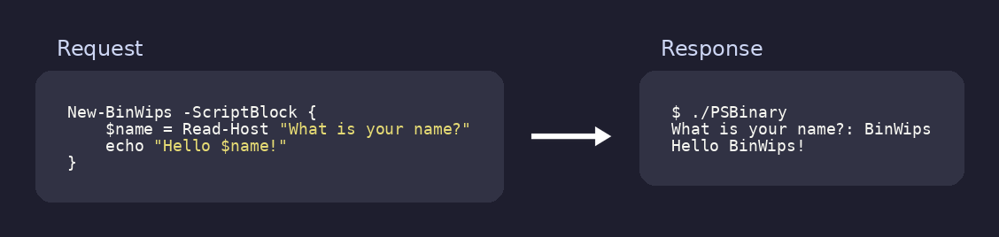
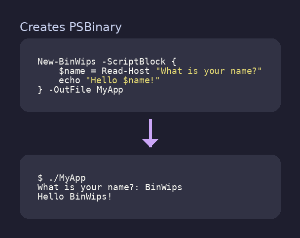

# codeimg

Compose code snippets, screenshots, and images into multi-panel
illustrations — for READMEs, docs, blog posts, and tutorials. Pass
panels as positional args (code, file paths, or images), or paste
markdown interactively. Horizontal or vertical layouts with arrows
between panels.


## Install

```bash
uv tool install .
```

Or run inside the project without installing globally:

```bash
uv run codeimg --help
```

## Use

### Interactive (recommended)

Run `codeimg` with no arguments. Each block opens a multi-line editor:

- Arrow keys move the cursor (including across lines)
- **Enter** submits the block
- **Alt+Enter** (or **Ctrl+J**) inserts a newline
- **Ctrl+C** to abort

To insert a clipboard image as a panel: copy the image, then submit an
empty block (press Enter on a blank line). The clipboard contents become
the next panel.

```text
$ codeimg --out out.png
--- Block 1 ---
def hi():
    print("hello")            ← Alt+Enter for newline, Enter to submit
[a]dd / [d]one / [e]dit N / [r]emove N / [q]uit: a
--- Add block 2 ---
                              ← Enter on blank line; clipboard image grabbed
[Image 2]
```

Clipboard images are fetched via `wl-paste` or `xclip`. The same image
is only added once — copy a new image to add another.

When stdin isn't a TTY (piped input, scripts), the editor falls back to
line-based input: two blank lines or Ctrl+D end a block.

### Markdown syntax

A line of plain text immediately above a ```` ```lang ```` fence becomes
the panel title. Multiple fenced blocks → multiple panels with arrows
between them. Plain (un-fenced) text becomes an auto-detected code panel.

### Single panel

If only one block is supplied, no arrow or empty right card is drawn.


### Two panels



### Vertical layout

Pass `--vertical` (works in CLI and interactive mode) to stack panels
top-to-bottom with a downward arrow between them.



### From the command line

Pass one or more positional panel inputs. Each one is auto-detected:

- an existing **image file** (`.png`, `.jpg`, `.gif`, `.webp`, …) → image panel
- an existing **code file** → code panel, language inferred from extension
- `path:N` or `path:N-M` (or `path:N:M`) → slice the file to those lines
- anything else → literal code string

```bash
codeimg 'print("hi")' 'hi' --out out.png
codeimg input.png output.png --no-border --out diff.png
codeimg src/cli.py:1-30 --out top.png
codeimg before.py after.py --title Before After --out diff.png
codeimg 'def add(a, b): return a + b' --out single.png    # one arg => single panel
```

Per-panel metadata uses parallel lists:

- `--title T1 T2 ...` — panel titles
- `--lang py rust ...` — language hints (override extension guess)
- `--file foo.py bar.rs ...` — filename hints for lexer guessing
- `--max-width 800 1200 ...` — per-panel max content width

Other flags: `--vertical` (stack top-to-bottom), `--no-border` (no inner card
around images), `--arrow-color` (hex like `#aabbcc` or named like `white`),
`--no-clip` (skip clipboard copy, default copies),
`--out` (`.png`, `.webp`, `.gif`).

## As a library

```python
from codeimg import Panel, compose_panels, parse_markdown, render_code_image

panels = parse_markdown(open("README.md").read())
items = [(render_code_image(p.code, p.lang, None), p.title, False) for p in panels]
img = compose_panels(items)
img.save("out.png")
```

## Development

```bash
uv sync --group dev
uv run pytest          # 22 tests, ~1s
```

Sample outputs in `docs/img/` are regenerated by `tests/test_samples.py`,
so any visual change is reflected in the README screenshots.
