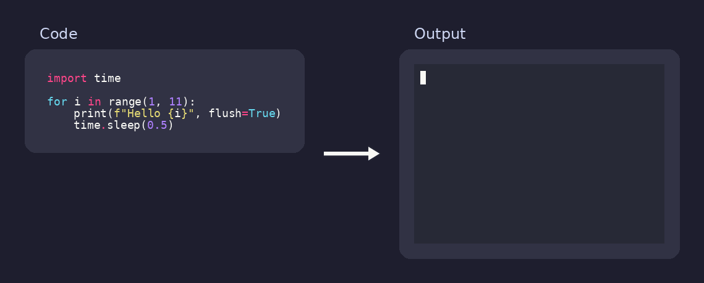

# stackshot

Compose code snippets, screenshots, and images into multi-panel
illustrations. Pass panels as positional args (code, file paths, or
images), or paste markdown interactively. Horizontal or vertical
layouts with arrows between panels.


There's also a **browser version** that runs entirely client-side — no
upload, no signup — for quick one-off compositions. See
[`src/web/README.md`](src/web/README.md) for the dev/deploy story (Azure
Static Web Apps free tier).

## Install

From PyPI (Python ≥ 3.10):

```bash
uv tool install stackshot     # or: pipx install stackshot
```

Standalone binary (no Python required) — download the asset for your
platform from the [latest release](https://github.com/d-carrigg/stackshot/releases/latest):

- `stackshot-linux-x86_64`
- `stackshot-macos-arm64`
- `stackshot-windows-x86_64.exe`

`chmod +x` and put it on your PATH (Linux/macOS).

From a checkout of this repo:

```bash
uv tool install .       # install globally from source
uv run stackshot --help   # or run without installing
```

## Use

### Interactive

Run `stackshot` with no arguments. Each block opens a multi-line editor:

- Arrow keys move the cursor (including across lines)
- **Enter** submits the block
- **Alt+Enter** (or **Ctrl+J**) inserts a newline
- **Ctrl+C** to abort

To insert an image as a panel: copy the image, then paste (your
terminal's paste — usually **Ctrl+Shift+V** on Linux/Windows, **Cmd+V**
on macOS). If the clipboard has an image, it's added as the next panel
and the editor auto-advances. If the clipboard has text, the paste
behaves normally and you stay in the editor. (Clipboard image fetch
uses Pillow's `ImageGrab`; on Linux it shells out to `wl-paste` or
`xclip` — install one if image paste returns nothing.)

```text
$ stackshot --out out.png
--- Block 1 ---
def hi():
    print("hello")            ← Alt+Enter for newline, Enter to submit
[a]dd / [d]one / [e]dit N / [r]emove N / [q]uit: a
--- Add block 2 ---
                              ← paste while an image is on the clipboard
[Image 2]
```

When stdin isn't a TTY (piped input, scripts), the editor falls back to
line-based input: two blank lines or Ctrl+D end a block.

### Markdown syntax

A line of plain text immediately above a ```` ```lang ```` fence becomes
the panel title. Multiple fenced blocks → multiple panels with arrows
between them. Plain (un-fenced) text becomes an auto-detected code panel.

### Single panel


### Two panels


### Vertical layout

Pass `--vertical` (works in CLI and interactive mode) to stack panels
top-to-bottom with a downward arrow between them.


### Animated output (code → gif)

If one of the panels is an animated GIF or WebP, stackshot produces an
animated output frame-by-frame.



Reproduce: `docs/examples/print_loop.py` is the script;
`docs/examples/record_print_loop.sh` records it with asciinema + agg
to refresh `docs/img/print_loop.gif`, and
`uv run pytest tests/test_samples.py::test_sample_code_to_gif`
composes the code + recording into `docs/img/code-to-gif.gif`.

### From the command line

Pass one or more positional panel inputs. Each one is auto-detected:

- an existing **image file** (`.png`, `.jpg`, `.gif`, `.webp`, …) → image panel
- an existing **code file** → code panel, language inferred from extension
- `path:N` or `path:N-M` (or `path:N:M`) → slice the file to those lines
- anything else → literal code string

```bash
stackshot 'print("hi")' 'hi' --out out.png
stackshot input.png output.png --no-border --out diff.png
stackshot src/cli.py:1-30 --out top.png
stackshot before.py after.py --title Before After --out diff.png
stackshot 'def add(a, b): return a + b' --out single.png    # one arg => single panel
```

Per-panel metadata uses parallel lists:

- `--title T1 T2 ...` — panel titles
- `--lang py rust ...` — language hints (override extension guess)
- `--file foo.py bar.rs ...` — filename hints for lexer guessing
- `--max-width 800 1200 ...` — per-panel max content width

Other flags: `--vertical` (stack top-to-bottom), `--no-border` (no inner card
around images), `--arrow-color` (hex like `#aabbcc` or named like `white`),
`--no-clip` (skip clipboard copy, default copies),
`--out` (`.png`, `.webp`, `.gif`).

## As a library

```python
from stackshot import Panel, compose_panels, parse_markdown, render_code_image

panels = parse_markdown(open("README.md").read())
items = [(render_code_image(p.code, p.lang, None), p.title, False) for p in panels]
img = compose_panels(items)
img.save("out.png")
```

## Development

```bash
uv sync --group dev
uv run pytest
```

Sample outputs in `docs/img/` are regenerated by `tests/test_samples.py`,
so any visual change is reflected in the README screenshots.

See [CLAUDE.md](CLAUDE.md) for the release flow (feature branch → bump
version → PR → merge → tag + binaries).
