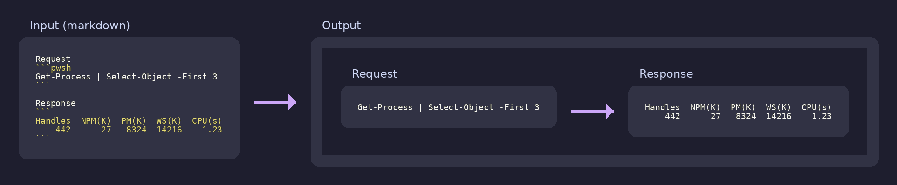
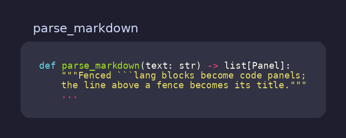

# codeshot

Generate side-by-side code/image screenshots from markdown. Useful for
docs, README hero shots, blog posts, and request/response diagrams.



## Install

```bash
uv tool install .
```

Or run inside the project without installing globally:

```bash
uv run codeshot --help
```

## Use

### Interactive (recommended)

Run `codeshot` with no arguments. Paste code or markdown, end each block
with two blank lines (or Ctrl+D), then pick an action.

```text
$ codeshot --out out.png
Codeshot interactive mode
Paste code or markdown. Use ```lang fences to set syntax; the line above
a fence becomes its title. End each block with two blank lines (or Ctrl+D).
Type 'i' at the action prompt to paste a clipboard image.

--- Block 1 ---
Request
```pwsh
Get-Process | Select-Object -First 3
```


[a]dd / [i]mage / [d]one / [e]dit N / [r]emove N / [q]uit: a

--- Add block 2 ---
Response
```
Handles  NPM(K)  PM(K) ...
```


[a]dd / [i]mage / [d]one / [e]dit N / [r]emove N / [q]uit: d
```

Type `i` at the action prompt to add the current clipboard image as the
next panel (uses `wl-paste` or `xclip`).

### Markdown syntax

A line of plain text immediately above a ```` ```lang ```` fence becomes
the panel title. Multiple fenced blocks → multiple panels with arrows
between them. Plain (un-fenced) text becomes an auto-detected code panel.

### Single panel

If only one block is supplied, no arrow or empty right card is drawn.



### Two panels


### From the command line

```bash
codeshot --left 'print("hi")' --right 'hi' --out out.png
codeshot --left-image input.png --right-image output.png --no-border --out diff.png
codeshot --left 'def add(a, b): return a + b' --out single.png   # no --right => single panel
```

Useful flags: `--left-lang`, `--right-lang` (language hints), `--no-border`
(skip the inner card around images), `--out` (`.png`, `.webp`, `.gif`).

## As a library

```python
from codeshot import Panel, compose_panels, parse_markdown, render_code_image

panels = parse_markdown(open("README.md").read())
items = [(render_code_image(p.code, p.lang, None), p.title, False) for p in panels]
img = compose_panels(items)
img.save("out.png")
```

## Development

```bash
uv sync --group dev
uv run pytest          # 22 tests, ~1s
```

Sample outputs in `docs/img/` are regenerated by `tests/test_samples.py`,
so any visual change is reflected in the README screenshots.
